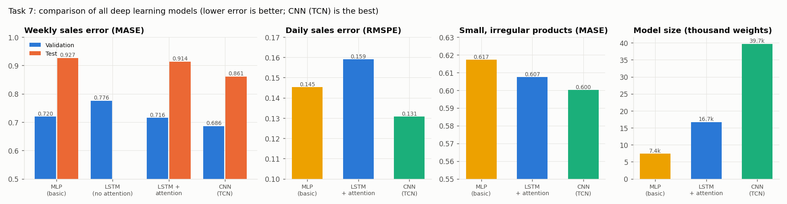
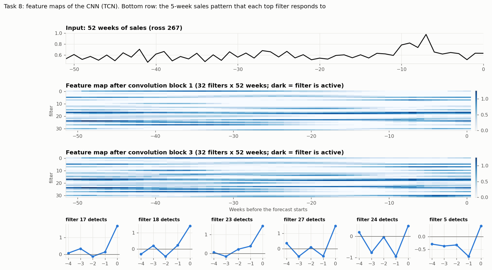
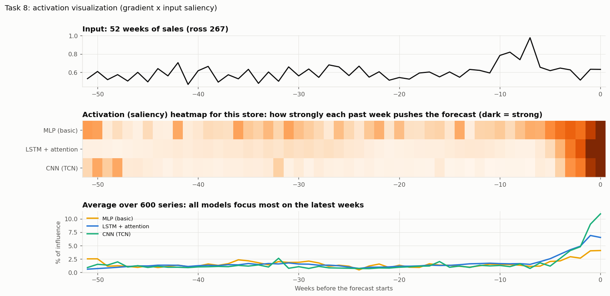
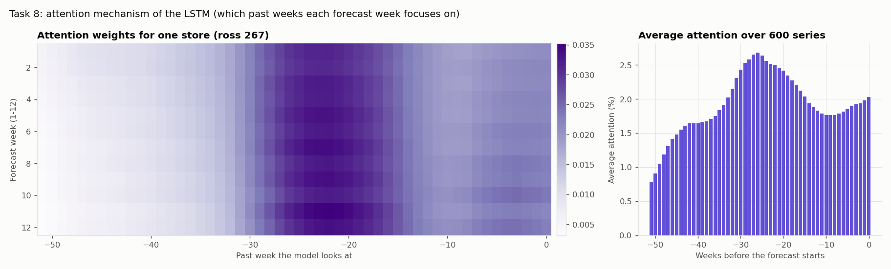
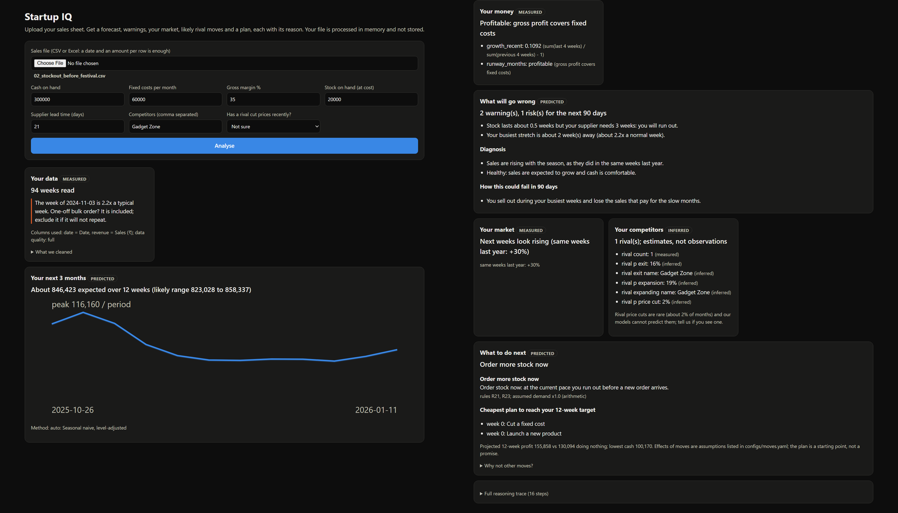
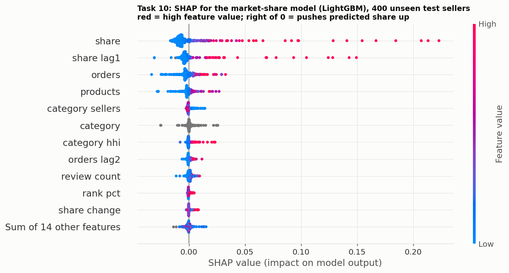
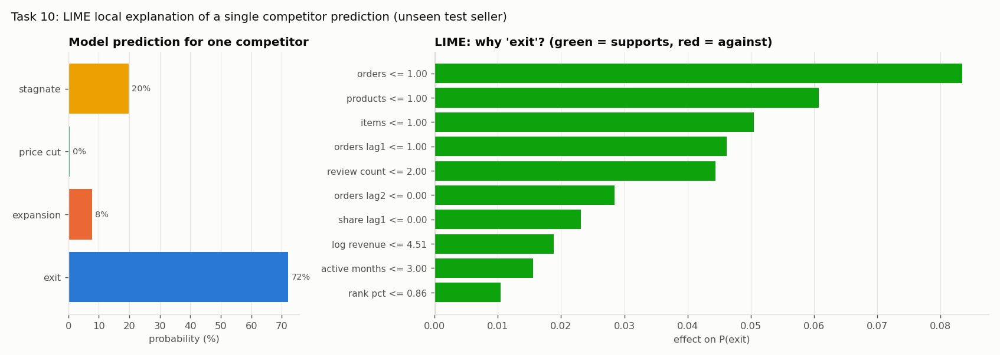

# Startup IQ: Tasks 7 to 10

## Task 7: Advanced deep learning architecture

**Aim.** Design and implement an advanced deep learning architecture (Convolutional Neural Network (CNN), Recurrent Neural Network (RNN), or Long Short-Term Memory (LSTM)) based on the data type. Train the model using appropriate hyperparameters and regularization techniques.

**Dataset used.** Weekly sales of 935 Rossmann stores and 1,604 UCI online-retail products (2,539 series). Each model uses 52 weeks of history to predict the next 12 weeks.

**Model used and why.** Sales data is a time sequence, so we used sequence models:
- **CNN (1D, TCN):** filters slide along time and cover a full year.
- **LSTM with attention:** remembers long patterns; attention focuses on important past weeks.
- **MLP:** the basic model, kept for comparison.

A plain RNN forgets long patterns, and a 2D image CNN does not fit sales data.

**Hyperparameters and regularization.**
- **Search:** random search over hidden size, layers, learning rate, dropout and weight decay.
- **Training:** AdamW optimiser, 30 epochs, on a GPU (RTX 2050).
- **Regularization:** dropout, weight decay, early stopping and gradient clipping.

**Result.**

| Model | Error (MASE, lower is better) | Small, irregular products |
| --- | --- | --- |
| MLP (basic) | 0.720 | 0.617 |
| LSTM + attention | 0.716 | 0.607 |
| **CNN (TCN)** | **0.686** | **0.600** |
| **Hybrid (classical + CNN)** | **0.603** | |

- Attention lowered the LSTM's error from 0.776 to 0.695.
- Dropout raised range accuracy from 74% to 83%.

**Output: comparison of all deep learning models**

**Conclusion.** The CNN is the best deep model, and it is used in the final hybrid forecaster.

## Task 8: Interpretability and visualization

**Aim.** Apply interpretability and visualization methods (feature maps, activation visualization, or attention mechanisms). Compare the performance and interpretability with the basic model.

**Dataset used.** 600 validation windows (300 stores and 300 products), using the trained models from Task 7.

**Methods used and why.**
- **Feature maps (CNN):** show the sales pattern each filter detects.
- **Attention (LSTM):** shows which past weeks the model focuses on.
- **Activation visualization (saliency):** shows how much each past week pushed the forecast.

**Result.**

| | MLP (basic) | LSTM + attention | CNN (TCN) |
| --- | --- | --- | --- |
| Error (MASE) | 0.720 | 0.716 | **0.686** |
| Influence of the last 4 weeks | 14% | 22% | 29% |
| Interpretability | Saliency only | Attention weights | Feature maps + saliency |

**Output 1: feature maps (CNN).** Each filter lights up on a sales pattern; most detect "a sudden jump in the latest week".

**Output 2: activation visualization.** All models focus most on the latest weeks.

**Output 3: attention mechanism (LSTM).** Shows which past weeks each forecast week looks at.

**Conclusion.** The CNN is both the most accurate and the easiest to interpret. Like a shopkeeper, it looks mostly at recent weeks and at the same week last year.

## Task 9: End-to-end intelligent system pipeline

**Aim.** Design and implement an end-to-end intelligent system pipeline by integrating Deep Learning, Machine Learning, and Artificial Intelligence for decision making.

**Dataset used.**
- **Input:** the founder's own sales file (CSV or Excel).
- **Training data:** Rossmann, UCI and Olist.
- **Testing:** 23 representative demo files.

**Approach.**
- **Deep Learning:** the CNN learns the patterns in sales.
- **Machine Learning:** predicts sales, competitor moves (random forest) and market share (LightGBM).
- **AI:** 47 IF-THEN rules and an A* planner decide the next move and explain why.

Everything runs as one pipeline behind a website.

**Output: the working website.** Demo file 02 (stock runs out before the festival) gives "Order more stock now":

More screenshots: `task9_3_website_stockout.png` (full page), `task9_4_website_price_war.png` (rival price cut gives "loyalty offer") and `task9_5_website_refused_file.png` (a file with no dates is refused with the reason).

**Result.**
- **Demo situations:** all 23 gave the correct decision. For example, stock about to run out gives "order stock now".
- **Messy files:** 25 of 25 handled correctly.
- **Planner:** A* found the cheapest plan every time.
- **Consistency:** the same input gives the same decision 40 out of 40 times.
- **Speed:** 0.26 seconds per analysis.

**Conclusion.** Deep Learning, Machine Learning and AI work together in one pipeline. Every decision shows the rule and the numbers behind it.

## Task 10: Validation, explainability, ethics and fairness

**Aim.** Validate the integrated intelligent system using unseen test inputs and evaluate its overall performance. Analyze the explainability of system decisions using model interpretation techniques. Identify and discuss ethical, fairness, and bias-related issues in system behavior.

**Dataset used.** 300 Olist sellers that were never used in training. The last 12 weeks of each seller were hidden and then predicted.

**Approach.**
- **Performance:** the forecast is compared with simple guesses.
- **Explainable AI:** SHAP and LIME explain the market-share and competitor models; every decision also shows its rules and the answer to "why not this move?".
- **Fairness:** results are split by seller size.

**Result.**

| Sellers | Startup IQ | Repeat last week |
| --- | --- | --- |
| All 300 | **0.982** | 1.036 |
| Small sellers | **0.917** | 1.101 |

**Output 1: SHAP (market-share model).** Current share and last month's share drive the prediction most.

**Output 2: LIME (one competitor).** The model predicts "exit" (72%) because the seller has very few orders, products and reviews.

More: `task10_4_shap_competitor.png` (SHAP for every competitor move) and `task10_1_unseen_validation.png`.

**Ethics, fairness and bias.**
- **Safety:** illegal moves are always refused, and broken files are rejected with a reason.
- **Privacy:** uploaded files are never stored.
- **Honesty:** competitor outputs are labelled as estimates.
- **Bias:** the training data comes from Germany, the UK and Brazil, so data from Indian shops is the next step.

**Conclusion.** On unseen sellers the system is accurate and fast. It works best for small sellers, its target users. Every decision is explainable and safe.
