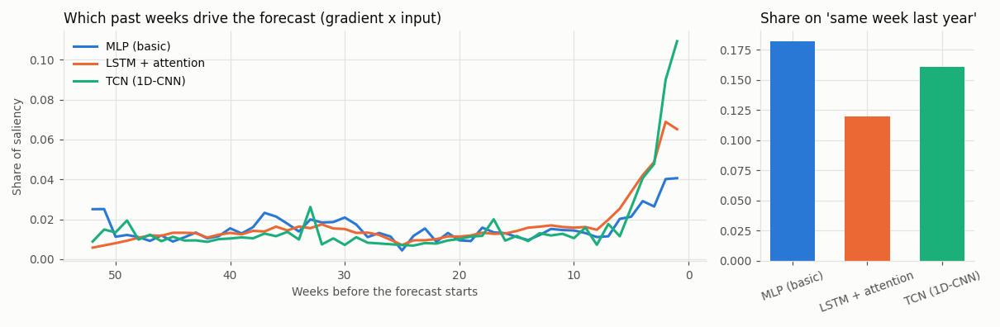
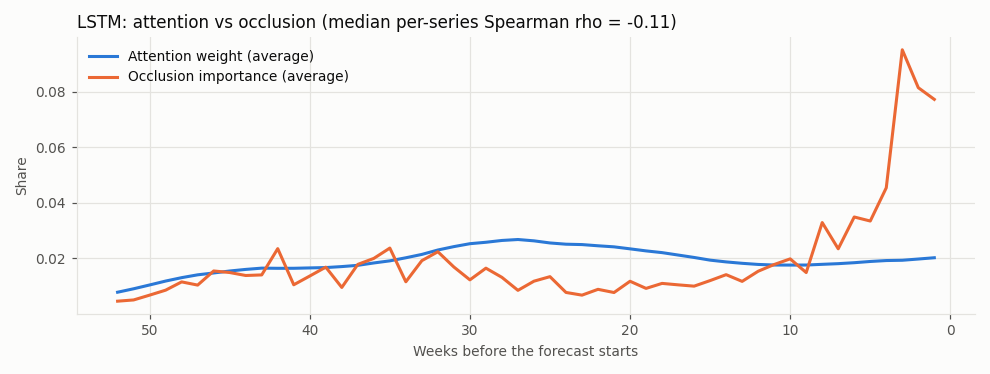
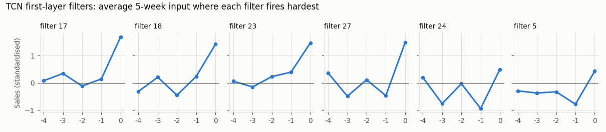
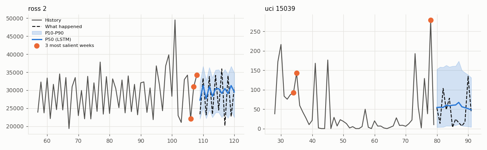

# Interpretability of the deep forecasters (Task 8)

Generated by `python -m startupiq.dl.interpret` on 2026-10-25. Do not edit by hand.

## Setup

600 validation windows (half Rossmann stores, half UCI products), models from the validation run.

## 1. Which past weeks drive the forecast

| model | share_last_4_weeks | share_seasonal_feature | share_52_weeks_back_window | rossmann_last_4 | uci_last_4 |
| --- | --- | --- | --- | --- | --- |
| mlp | 0.136 | 0.182 | 0.074 | 0.166 | 0.106 |
| lstm | 0.225 | 0.120 | 0.030 | 0.302 | 0.148 |
| tcn | 0.288 | 0.161 | 0.057 | 0.427 | 0.148 |

Shares are of total gradient x input; 'last 4 weeks' and '52 weeks back window' are the newest and oldest 4 lookback weeks.

## 2. Is the LSTM's attention a faithful explanation?

Per series, Spearman correlation between attention weights and occlusion importance: median -0.11 (interquartile -0.17 to -0.03); overlap of the top-5 weeks 4%; correlation of the average curves -0.00. Gradient saliency vs occlusion: median 0.63.

## 3. What the TCN's filters detect

- filter 17: fires on a sudden spike in the latest week
- filter 18: fires on a sudden spike in the latest week
- filter 23: fires on a sudden spike in the latest week
- filter 27: fires on a sudden spike in the latest week
- filter 24: mixed / level pattern
- filter 5: mixed / level pattern

## 4. Accuracy, calibration, cost and explainability

| model | pooled MASE | coverage | params | ms per series | how it explains itself |
| --- | --- | --- | --- | --- | --- |
| Moving average (4 weeks) | 0.751 | n/a | 0 | <0.1 | fully transparent: the average of the last 4 weeks |
| Auto (Step 5, serves today) | 0.616 | 0.946 / 0.587 | 0 | about 20 (fits ETS) | names the method it picked and its backtest error |
| LightGBM global (Step 5) | 0.815 | 0.339 / 0.719 | 600 trees | <1 | feature importance (global), no per-week attribution |
| mlp h32 l2 do0.3 lr0.001 wd0.0 | 0.7196 ± 0.0261 | 0.7800 ± 0.0420 | 7395 | 0.00 | gradient saliency only; no notion of order |
| lstm+attention h32 l2 do0.0 lr0.001 wd0.0001 | 0.7155 ± 0.0156 | 0.6030 ± 0.1376 | 16707 | 0.01 | attention weights (agree with occlusion: median rho -0.11) + saliency |
| tcn h32 l6 do0.1 lr0.001 wd0.0 | 0.6862 ± 0.0088 | 0.7482 ± 0.0521 | 39715 | 0.03 | feature maps (filters with readable shapes) + saliency |

Coverage for Step 5 models is Rossmann / UCI on validation; deep models show pooled coverage mean ± sd over 3 seeds.

## Case study

