# EDA summary (Task 4)

Generated by `python -m startupiq.eda` from `data/processed`. Do not edit by hand.

## Weekly sales over time

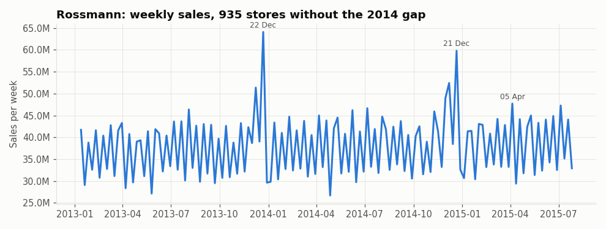

Clear yearly cycle; December weeks average 1.20x other weeks, peaking just before Christmas. The saw-tooth is Rossmann's alternating promo weeks: weeks with 5 promo days sell 1.36x weeks with none. Seasonal and promo features are both required.

## Weekday and month pattern

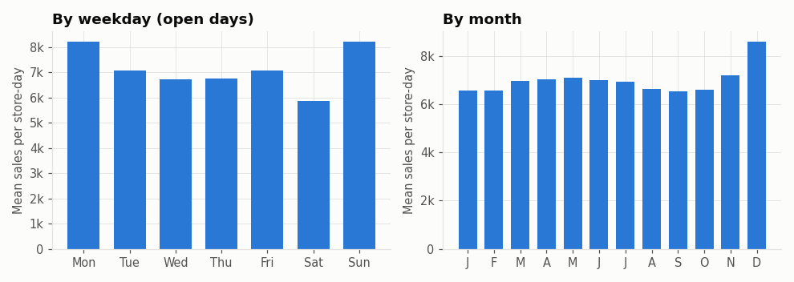

Highest mean is Sun (only 33 stores open on Sundays, so that bar is a small, unusual group); Monday is 1.19x Tue-Fri; December mean is 1.26x other months. Calendar features belong in every model.

## Promotion effect

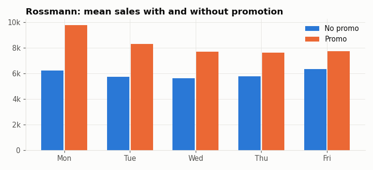

Promotion days sell 1.39x non-promo days on average across weekdays. Promo is the strongest controllable driver and the main 'move' the planner can use.

## Competitor distance

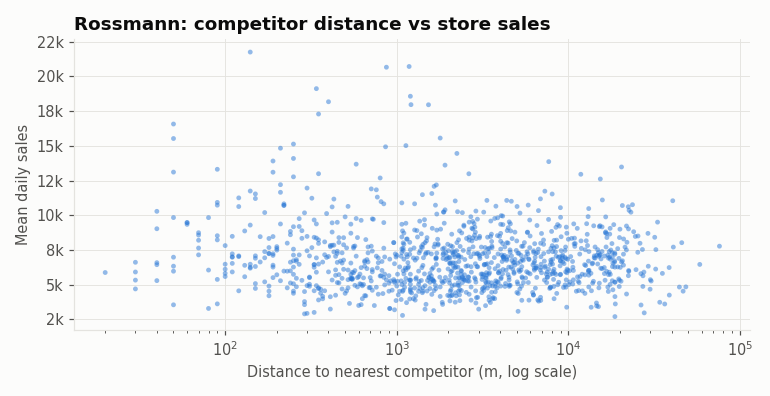

Spearman correlation -0.03: distance to the nearest rival barely relates to sales on its own. Competition matters through timing (rival opening dates), not distance.

## Missing values in store table

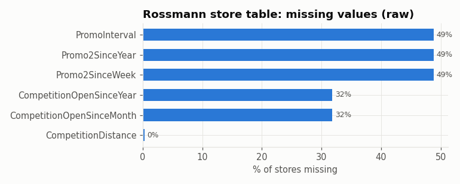

Promo2 fields are empty for stores not in Promo2 (structural, not missing); competition-open dates are truly unknown for 32% of stores and are flagged, not imputed.

## Store type

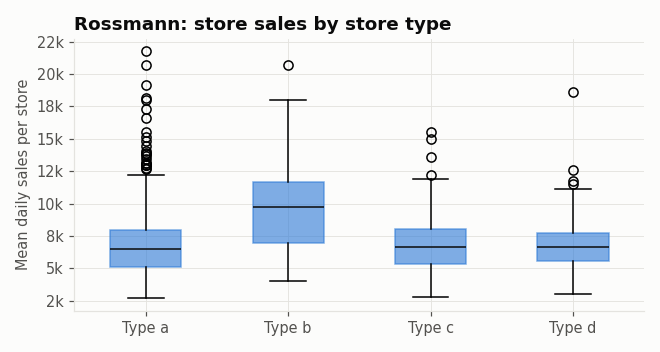

Type b (17 stores) sells far more per day than the rest; types differ in level, so per-series scaling is needed before a global model.

## Correlation heatmap

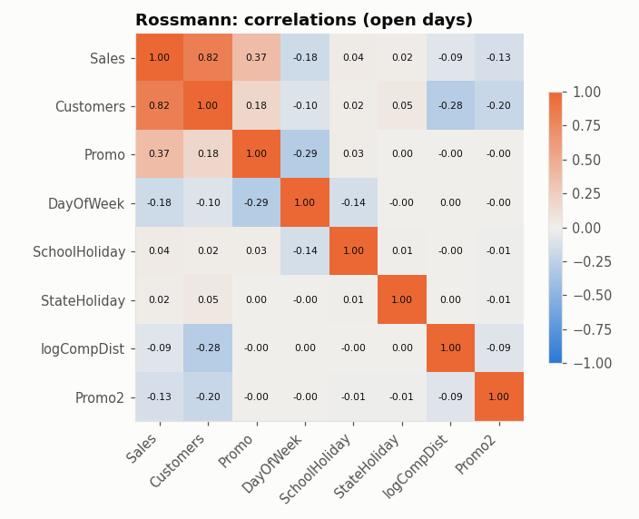

Customers correlate 0.82 with sales, but customer count is not known in advance, so it is excluded as a forecast input (leakage). Promo (0.37) is the strongest usable signal.

## Weekly revenue

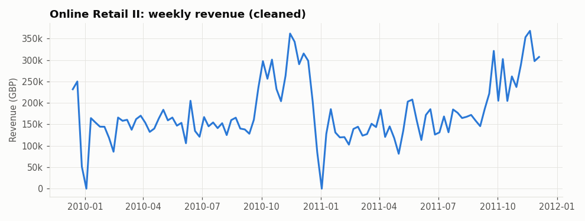

October-November weeks average 1.89x January-September weeks (a gift wholesaler stocking up for Christmas); the late-December drop to zero is closure, filled as zero weeks.

## Product sparsity

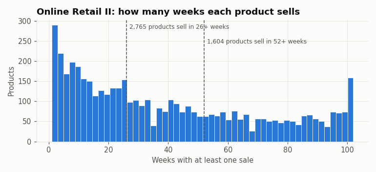

43% of products sell in fewer than 26 weeks: most product-level series are too sparse for a neural model; the global model trains on the 1,604 products with 52+ active weeks.

## Revenue by country

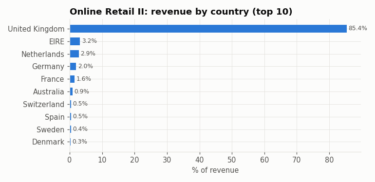

The United Kingdom makes 85% of revenue: results describe a UK business, a limitation for Indian small sellers (Task 10).

## Orders per month

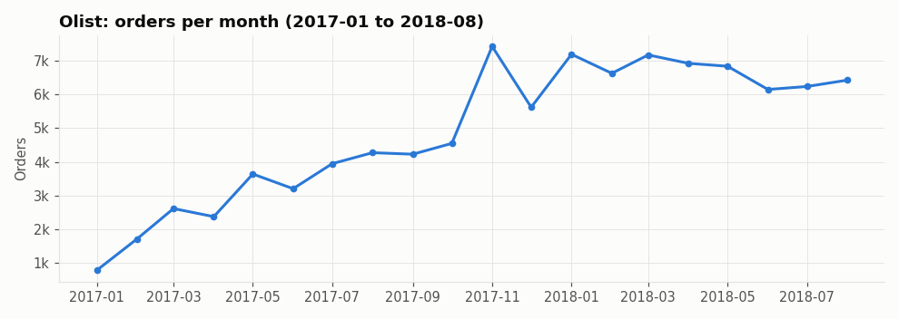

Orders grow 8.2x from the first to the last month: the marketplace itself is growing, so a seller's sales growth must be read against category growth (that is what market share does).

## Competitors per category

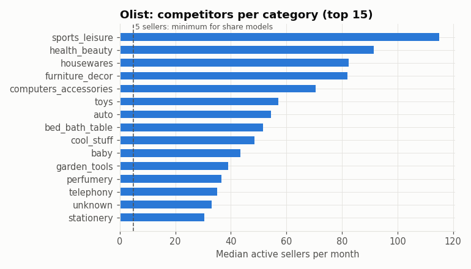

41 of 74 categories have a median of 5+ active sellers a month; share and competitor models are limited to these.

## Seller concentration

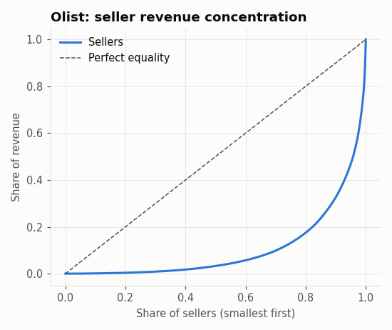

Gini 0.79: a few sellers take most revenue. Small sellers (the product's users) are the majority of rows but the minority of revenue, so errors must be reported by seller size (Task 10).

## Market share over time

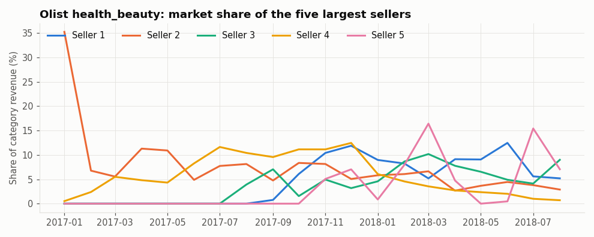

Leaders' shares move by several points month to month (category HHI 0.031 to 0.172); share changes are real and learnable, but noisy.

## Public market signals

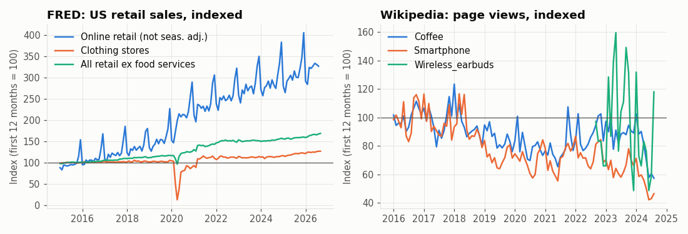

Online retail (MRTSSM4541USN) grew 81% from 2019 to 2023 vs 32% for all retail; page views move differently from sales, so they are a weak, optional trend input.
