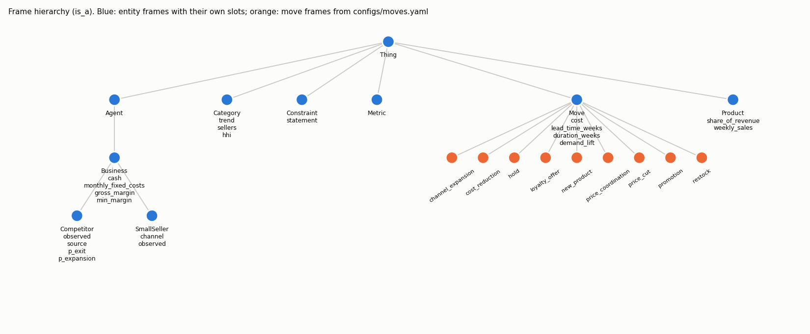
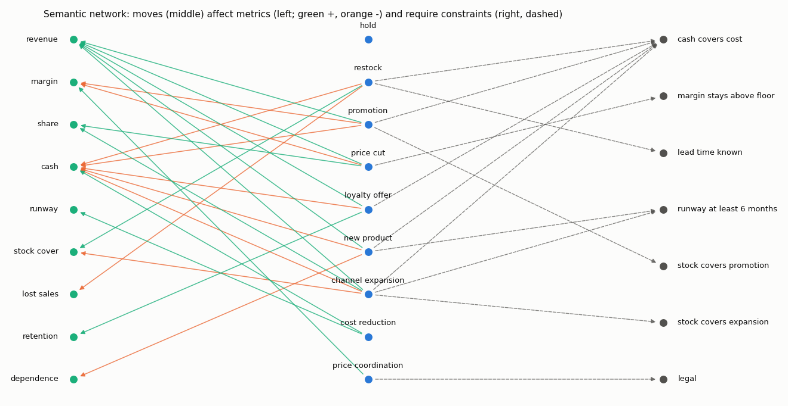

# Knowledge model (Task 1)

Generated by `python -m startupiq.knowledge`. Do not edit by hand.

## Class frames

| Frame | is_a | Own slots (default / range / if-needed) |
| --- | --- | --- |
| Thing | - | - |
| Agent | Thing | - |
| Business | Agent | cash (range (0, 1000000000000.0)), monthly_fixed_costs (range (0, 1000000000000.0)), gross_margin (default 0.3; range (0.0, 1.0)), min_margin (default 0.1; range (0.0, 1.0)), weekly_sales (range (0, 1000000000000.0)), monthly_sales (if-needed), runway_months (if-needed), stock_value (range (0, 1000000000000.0)), stock_cover_weeks (if-needed), supplier_lead_time_weeks (default 2; range (0, 52)), price_position (default 'similar'; range ('cheaper', 'similar', 'pricier')) |
| SmallSeller | Business | channel (default 'online'), observed (default True) |
| Competitor | Business | observed (default False), source (default 'inferred'; range ('inferred', 'measured')), p_exit (default 0.16), p_expansion (default 0.19), p_price_cut (default 0.02) |
| Product | Thing | share_of_revenue (range (0.0, 1.0)), weekly_sales (range (0, 1000000000000.0)) |
| Category | Thing | trend (default 'unknown'; range ('rising', 'flat', 'falling', 'unknown')), sellers (range (0, 10000000.0)), hhi (range (0.0, 1.0)) |
| Metric | Thing | - |
| Constraint | Thing | statement |
| Move | Thing | cost (default 0.0; range (0.0, 10.0)), lead_time_weeks (default 0), duration_weeks (default 1), demand_lift (default 1.0; range (0.5, 3.0)), margin_change (default 0.0), legal (default True; range (True, False)), requires (default []), affects (default {}), label, source (default 'assumption') |
| hold | Move | label (= 'Keep things as they are'), cost (= 0.0), lead_time_weeks (= 0), duration_weeks (= 1), demand_lift (= 1.0), affects, requires, source (= 'no change') |
| restock | Move | label (= 'Order more stock now'), cost_rule (= 'weeks_of_sales_at_cost'), weeks_ordered (= 4), lead_time_weeks (= 'supplier'), duration_weeks (= 0), demand_lift (= 1.0), affects, requires, source (= 'arithmetic') |
| promotion | Move | label (= 'Run a promotion (2 weeks)'), cost (= 0.05), lead_time_weeks (= 1), duration_weeks (= 2), demand_lift (= 1.2), affects, requires, source (= 'Rossmann promo days sell 1.39x (EDA); 1.2 assumed for small sellers without a brand') |
| price_cut | Move | label (= 'Cut prices by 10%'), cost (= 0.0), margin_change (= -0.1), lead_time_weeks (= 0), duration_weeks (= 4), demand_lift (= 1.15), affects, requires, source (= 'assumed price elasticity -1.5; not measured on our data') |
| loyalty_offer | Move | label (= 'Loyalty offer for repeat customers'), cost (= 0.03), lead_time_weeks (= 1), duration_weeks (= 4), demand_lift (= 1.05), affects, requires, source (= 'assumption') |
| new_product | Move | label (= 'Launch a new product'), cost (= 0.5), lead_time_weeks (= 6), duration_weeks (= 12), demand_lift (= 1.1), affects, requires, source (= 'assumption') |
| channel_expansion | Move | label (= 'Start selling on a new channel'), cost (= 0.3), lead_time_weeks (= 4), duration_weeks (= 12), demand_lift (= 1.15), affects, requires, source (= 'assumption') |
| cost_reduction | Move | label (= 'Cut a fixed cost'), cost (= 0.02), fixed_cost_change (= -0.1), lead_time_weeks (= 2), duration_weeks (= 0), demand_lift (= 1.0), affects, requires, source (= 'assumption') |
| price_coordination | Move | label (= 'Agree prices with a competitor'), cost (= 0.0), lead_time_weeks (= 0), duration_weeks (= 0), demand_lift (= 1.0), affects, requires, legal (= False), source (= 'Illegal cartel conduct (Competition Act 2002, s.3 in India; similar law elsewhere). In the ontology only so the system can recognise and refuse it.') |

## Constraints

| Name | Statement |
| --- | --- |
| cash_covers_cost | A move's cash cost must not exceed cash on hand. |
| margin_stays_above_floor | A pricing move must keep gross margin at or above the business's floor. |
| lead_time_known | Restocking needs a known supplier lead time. |
| runway_at_least_6_months | Moves that take a quarter to pay back need 6+ months of runway. |
| stock_covers_promotion | A promotion needs enough stock for the extra demand. |
| stock_covers_expansion | A new channel needs stock for the lead time plus a buffer. |
| legal | No move may break competition law (no price coordination). |

Semantic network: 35 nodes, 68 edges (affects, instance_of, is_a, requires).
